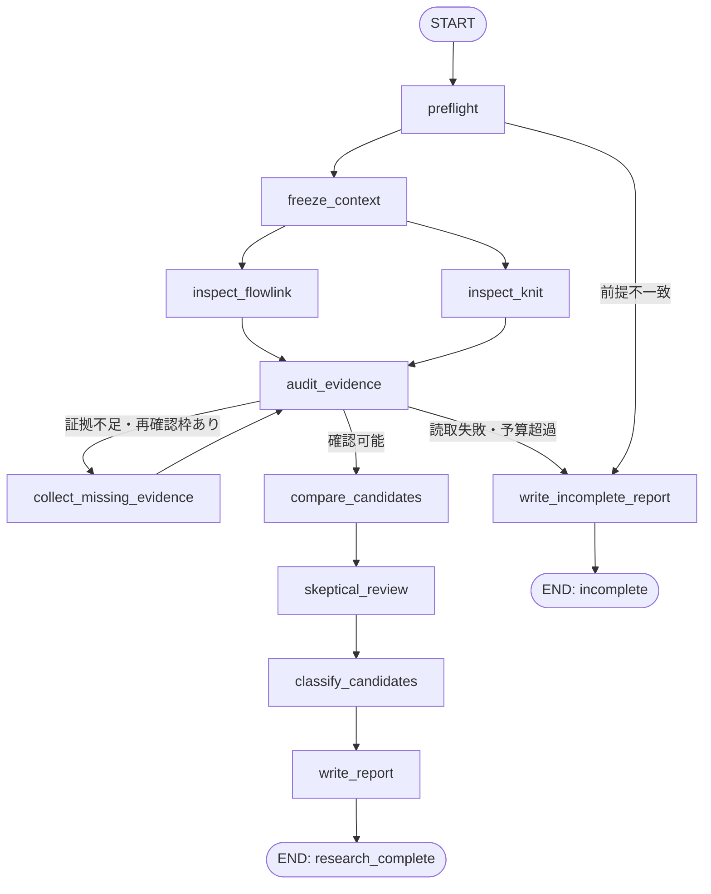
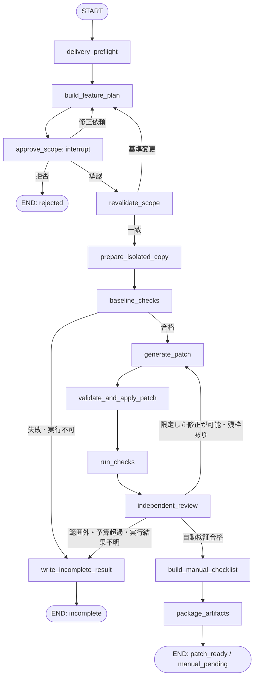

# Knit のGUI改善を支援する LangGraph 設計

作成日: 2026-10-16
状態: 設計案。実装・起動・依存追加・アプリ変更は未実施。
対象: FlowLinkを参考に、KnitのGUI設定と追加機能を調査・提案し、別途承認された範囲だけ実装候補を作る。

## 1. 設計の前提

[研究レポート][research]と[設定画面の方針][settings]を入力資料とする。
ユーザーは前フェーズで「研究のみ」を選択している。今回の設計依頼を、コード変更や自動改善ループの実行許可とは扱わない。

採用案は **LangGraph.js / TypeScript、研究グラフと実装グラフの分離、ローカル永続化、人による承認**。
既存の[FlowLink用オーケストレーター][orch-readme]と技術を合わせる。KnitのRustアプリへLangGraphを組み込むのではなく、外部の開発支援プロセスとして動かす。
LangGraphのノードは論理的な担当であり、全ノードがLLMや別エージェントを必要とするわけではない。

### 今回の設計で守る条件

1. 通常モードは読み取り専用の調査。実装グラフへ遷移するエッジを持たない。
2. 参照元のUIが存在しても、保存・処理への反映・実機確認を別々に判定する。
3. 失敗や未確認を「問題なし」「実装済み」に変換しない。
4. 元の作業ツリーは変更しない。承認後の実装も隔離コピーで行い、差分を成果物として返す。
5. 自動コミット、変更の一括取消し、配備、自動起動登録、認証情報の変更は行わない。
6. LLMのプロンプトだけを権限制限としない。ツールを渡さない、ファイル範囲を制限するなど、実行層で制約する。

## 2. 既存基盤の評価

参照した基盤のHEADは `0b94b09`。[依存設定][orch-package]は `@langchain/langgraph: ^1.5.0` を指定している。
これは宣言上のバージョン範囲であり、今回インストール済みバージョンの動作保証を行ったものではない。

| 既存の構成・動作 | Knit向けの扱い |
|---|---|
| `StateGraph` と `Annotation.Root`、並列レビュー、条件付き再試行 | 構成の参考として再利用する |
| レビュー／修正／検証をplain async関数として分離 | 方針を継続。ただし戻り値を厳密な型と検証付きにする |
| JSON解析失敗時に `issues: []` として続行 | 廃止。`invalid_output` として記録し、最大1回再取得後に停止 |
| 修正役が `git add -A`、コミット、失敗時の一括取消しまで実行 | 廃止。LLMはパッチ案を返し、適用・検証は別の実行層が担当 |
| コマンドを任意のshell文字列として渡す | 登録済みの実行ファイル・引数・cwd・タイムアウトへ変更 |
| 例外発生後も次のラウンドを継続 | 初期版は停止。後続への影響がないと確認された場合だけ人が再開 |
| `compile()` にcheckpointerを渡していない | 永続checkpointerと `thread_id` を導入 |
| 一部の終了コードを自動再試行 | 利用者の中止は再試行しない。読み取りの一時障害と副作用処理を分ける |

根拠: [ラウンドグラフ][orch-round]、[エージェント実装][orch-agents]、[CLIラッパー][orch-llm]、[ループドライバ][orch-driver]。
既存ソース自体は今回変更していない。

## 3. 全体構成

```text
人・CLI/管理UI
  ├─ 研究実行 ─ ResearchGraph ─ 調査結果・候補・未確認一覧
  │                             ここで終了
  └─ 別途、実装案の作成を依頼
       └─ DeliveryGraph ─ 対象承認待ち ─ 隔離実装 ─ 検証 ─ パッチ・確認表

共通部品
  EvidenceReader / SchemaValidator / PolicyEnforcer / ArtifactStore
  ApprovalAdapter / Checkpointer / OperationJournal / ProcessSupervisor
```

初期版はCLIを想定する。既存のDSH GUIへの接続や、FlowLinkアプリ自身の操作は含めない。
CLIの承認入力とDSHのツール実行許可は別物であり、グラフ内の承認を理由にホスト側の制限を回避しない。

### 実行モード

| モード | 許可される処理 | 終了時の成果物 |
|---|---|---|
| `research`（既定） | 許可されたソース・文書・画像の読み取り、構造化分析、結果保存 | 研究レポート、証拠一覧、候補一覧 |
| `delivery`（将来実装） | 人が承認した機能について隔離コピーでパッチ生成・限定適用・テスト | パッチ、変更一覧、検証結果、手動確認表 |
| 本番反映・配備 | 初期版では提供しない | 別の人手作業として扱う |

## 4. 研究グラフ



図の合流は、LangGraph実装時に `addEdge(["inspect_flowlink", "inspect_knit"], "audit_evidence")` で両ノードの完了を待つ。
両ノードは内部で無制限のLLM再試行を行わず、それぞれ1つの構造化結果を返す。
合流時に期待する担当ID・スナップショットID・件数を確認し、片方の失敗を成功扱いしない。

| ノード | 種別 | 入力 → 出力 | 権限・判定 |
|---|---|---|---|
| `preflight` | 決定的処理 | 依頼・設定 → 対象・モード・制約 | パスを正規化。研究対象と出力先を分離。秘密情報を除外 |
| `freeze_context` | 決定的処理 | 対象 → immutableな読取資料とmanifest | HEADだけでなく未コミット・未追跡の許可ファイルを含めhash化 |
| `inspect_flowlink` | 読取＋LLM | 参照スナップショット → 項目・処理状況 | NativeとPreviewを区別。元ファイルを直接編集できない |
| `inspect_knit` | 読取＋LLM | Knitスナップショット → 現状・制約 | GUI、保存、実利用の処理、Mac/Win差分を確認 |
| `audit_evidence` | 決定的処理中心 | 両調査 → 確認済み・不足・矛盾 | パス・hash・引用範囲を確認。意味上の根拠も点検 |
| `collect_missing_evidence` | 読取＋LLM | 不足リスト → 追加証拠 | 固定済みスナップショット内だけを読む。1回まで |
| `compare_candidates` | LLM | 確認済み証拠 → 候補 | 完全新規、GUI未接続、既存、不採用候補、設計変更を分類 |
| `skeptical_review` | 別呼出しのLLM | 候補＋証拠 → 反証・過大評価 | 原案を書いた呼出しとは文脈を分離。相対評価であり真実の保証ではない |
| `classify_candidates` | ルール＋分析 | 候補・反証 → P0/P1/P2/保留 | UIだけの実装や認証設計の小変更扱いを拒否 |
| `write_report` | レンダラー | 確定データ → Markdown/JSON | 既知・提案・未確認を分ける。Knit自体には書き込まない |
| `write_incomplete_report` | レンダラー | 途中結果・失敗 → 未完了報告 | 不足対象を列挙し、研究完了とは呼ばない |

### 項目ごとの必須確認

| 層 | 確認する内容 | 証拠がない場合 |
|---|---|---|
| UI | 画面・ラベル・コントロール・有効条件 | `unknown`。設計モックを実装済みとしない |
| 保存 | 型・既定値・検証・書込・失敗時の値 | 保存済みとは判定しない |
| 実利用 | どの処理が値を読み、どう動作を変えるか | `stored_only` または `unknown` |
| 実行時 | 実OS・GUI・相手機で何を観測したか | `not_run`。コード検査と実機確認を混同しない |
| 安全性 | 秘密情報、取消し、他端末への影響 | 設計変更が必要ならP2、または保留 |

「見つからなかった」は「存在しない」の証明ではない。確認した検索範囲を記録する。
関数のコメントと実際の呼出し元が矛盾した場合は、両方を証拠に残す。

## 5. 実装グラフ（将来用）

研究グラフから自動起動しない。別の依頼・実行IDで開始する。
研究資料のhashを固定し、元資料が更新された場合は差分再確認を先に行う。



`generate_patch` はツールなしのLLMにパッチを作らせる。任意shell実行権限や元リポジトリへの書込権限を渡さない。
`validate_and_apply_patch` がパス・基準hash・変更範囲・ファイル種別を検査してから隔離コピーに適用する。
コンテキスト不足や大きな修正では、安全にパッチを生成できないとして停止してよい。

### 承認の範囲

`approve_scope` には、対象機能、影響するOS、変更許可パス、基準スナップショット、検証項目、上限、残る実機確認を表示する。
承認はこれらのhashに紐づける。対象外のファイルや新しい副作用が必要になったら自動で範囲を広げず、計画へ戻る。
同じ範囲内の限定修正は初回を含め2試行まで。承認後の元ファイルの変更は承認を失効させる。

承認ノードには `interrupt()` の前後で書込み・プロセス起動を置かない。
再開時にはノード冒頭から再実行されるため、承認表示と応答検証だけを担当させる。
`interrupt()` は通常のエラー処理で握りつぶさない。[公式Interrupts][lg-interrupts]

### 終了状態

- `patch_ready`: 必須の自動検証・独立レビューを通過し、配布可能なパッチを作成した状態。本番反映済みではない。
- `manual_pending`: `outcome = patch_ready` と `manualStatus = pending` の組合せの表示名。実機でしか確認できない項目が残る。自動テスト合格でも「全機能確認済み」とは表示しない。
- `incomplete`: 必須チェックが失敗・不明・実行不可、または制限に到達した状態。
- `rejected` / `cancelled`: 人が拒否・中止した状態。

実機確認結果を後から登録する場合は、パッチhash、機体・OS、確認項目、観測結果を指定する。
変更後の別パッチへ以前の確認結果を流用しない。入力・音声・登録削除などの実操作は別途明示許可が必要。

## 6. 状態とデータ契約

ノード間にはJSONで保存できる値だけを渡す。子プロセス、モデルクライアント、DB接続、実行権限はStateに入れない。
以下は型の設計例であり、実装済みのAPIではない。

```typescript
type ResultStatus = "ok" | "failed" | "invalid_output" | "not_run";
type Evidence = {
  id: string;
  repository: "knit" | "flowlink";
  snapshotId: string;
  path: string;
  fileSha256: string;
  startLine: number;
  endLine: number;
  claim: string;
  layer: "ui" | "persistence" | "consumer" | "runtime";
  support: "code" | "test_source" | "executed_test" | "document" | "mock";
};
type Candidate = {
  id: string;
  title: string;
  classification: "new" | "ui_unwired" | "existing" | "architecture" | "unknown";
  priority: "P0" | "P1" | "P2" | "defer";
  platforms: Array<"macos" | "windows">;
  referenceEvidenceIds: string[];
  currentEvidenceIds: string[];
  risks: string[];
  acceptanceChecks: string[];
  manualChecks: string[];
};
type ReviewResult = {
  taskId: string;
  snapshotId: string;
  status: ResultStatus;
  evidenceIds: string[];
  findingIds: string[];
  coveredPaths: string[];
  gaps: string[];
};
type RunState = {
  schemaVersion: 1;
  runId: string;
  mode: "research" | "delivery";
  contextManifestRef: string;
  contextHash: string;
  reportsByTask: Record<string, ReviewResult>;
  evidenceById: Record<string, Evidence>;
  candidatesById: Record<string, Candidate>;
  selectedFeatureId: string | null;
  planHash: string | null;
  approvalRecordId: string | null;
  isolatedTreeRef: string | null;
  patchRef: string | null;
  patchHash: string | null;
  checkResultsRef: string | null;
  researchFollowups: number;
  patchAttempts: number;
  outcome: "running" | "research_complete" | "patch_ready" |
    "incomplete" | "rejected" | "cancelled";
  manualStatus: "not_required" | "pending" | "passed" | "failed";
};
```

状態の検証は実装時にZod等のスキーマ検証で行う。型アサーションだけではLLM応答を信用しない。
`support: "test_source"` はテストコードがあるだけで、実行合格とは異なる。

### 並列更新とreducer

`reportsByTask` と `evidenceById` はIDをキーにしたマップとしてreducerで結合する。
同一ID・同一内容は無変更、同一ID・異なる内容は契約違反として停止する。単純な配列appendによる再開時の重複を避ける。
結合は順序に依存せず、表示時にID順へ整列する。
再確認は `taskId = 担当 + snapshotId + iteration` として別の結果を返し、古い結果を上書きしない。
単一writerの項目はlast-valueでよい。失敗後の再試行で前回の成功フラグを残さず、チェック結果をパッチhash単位で区別する。

## 7. LangGraph APIへの対応

既存基盤に合わせ、初期実装は `StateGraph` / `Annotation.Root` を使用する案とする。
新しい公式例の `StateSchema` へ同時移行することは今回の目的に含めない。
バージョンをlockfileで固定し、そのバージョンで合流・承認再開・永続化の契約テストを実行してから使用する。

| 要件 | 使用する仕組み |
|---|---|
| 固定2担当の調査 | `addEdge(START, ...)` によるfan-outと配列指定のfan-in |
| 調査対象が増える将来拡張 | `Send` で動的分配。ただし初期版は未使用 |
| 条件分岐 | `addConditionalEdges`。routingと通常edgeを重ねて二重実行させない |
| 承認待ち・再開 | `interrupt()`、同じ `thread_id` への `Command({ resume: ... })` |
| 永続化 | ローカルはSQLite checkpointer。MemorySaverはテスト限定 |
| 共通処理 | グラフ外のasync関数。実装ループを後にsubgraph化する場合も権限は外部で管理 |

次は承認ノードの構造例。`ScopeResponseSchema` と `approvalAdapter` は実装予定のアプリ独自部品で、LangGraph標準APIではない。

```typescript
import { interrupt, Command } from "@langchain/langgraph";

async function approveScope(state: RunState) {
  const raw = interrupt({
    kind: "approve_scope",
    runId: state.runId,
    contextHash: state.contextHash,
    planHash: state.planHash,
    featureId: state.selectedFeatureId,
  });
  const response = ScopeResponseSchema.parse(raw);
  // 応答内の approved:true だけでは許可しない。
  // 信頼されたCLI/UIで登録した人の意思決定と、今回のhashを照合する。
  const decision = await approvalAdapter.verify(response, state);
  return {
    approvalRecordId: decision.recordId,
    scopeDecision: decision.action, // approve / revise / reject
  };
}

// compile({ checkpointer }) 済みグラフに対し、同じthreadで再開する。
await deliveryGraph.invoke(
  new Command({ resume: verifiedHumanResponse }),
  { configurable: { thread_id: runId } },
);
```

`scopeDecision` はDelivery専用Stateで追加する。上のRunStateは共通部分だけを示している。
承認ノードの後は条件付きedgeで分岐する。LLMやリポジトリ中の文章が承認データを生成しても、ApprovalAdapterは受け付けない。

根拠: [Graph API][lg-api]、[Workflows and agents][lg-workflows]、[Interrupts][lg-interrupts]、[Checkpointers][lg-checkpointers]。

### モデルの選択

役割は `analyst`、`skeptic`、`patchAuthor` の3つとし、モデルIDは設定から注入する。
初期実装の既定はmockとし、実モデル・外部送信先は起動時に明示する。
既存基盤のモデル名を将来も利用可能と仮定しない。モデルを選べない場合に、別providerへ無断で切り替えない。
調査の2担当は同じモデルでもよいが、反証レビューは別呼出しとし、元の推論過程ではなく候補・証拠・反証観点だけを渡す。
モデル数を増やすことを検証の代わりにはしない。

## 8. 保存・再開・副作用の管理

### 保存対象

実装時にはユーザーのローカル状態ディレクトリ配下へ、プロジェクト別・実行ID別に次を保存する。
具体の配置先は起動時に決め、元リポジトリ内へ認証情報やDBを作らない。

```text
<private-state-root>/knit/
  checkpoints.sqlite
  runs/<run-id>/
    request.json
    context-manifest.json
    evidence.json
    candidates.json
    approvals.json
    operations.jsonl
    artifacts/
      research.md
      change.patch
      checks.json
      manual-checks.md
```

これは予定構成で、現在これらのファイルを作成したわけではない。
ディレクトリは所有者限定、DB・ログ・承認情報も他ユーザーへ公開しない。生のトークン、クリップボード本文、秘密鍵を保存しない。
ソース本文を外部LLMへ送る場合も許可ファイルの必要部分だけとし、環境変数や資格情報を自動で引き継がない。

### 再開の条件

1. 同じ `thread_id = runId` と永続checkpointerを使う。
2. `schemaVersion`、graph version、設定hash、スナップショットhashを照合する。
3. 当該runの単一実行ロックを取り、別プロセスから同じthreadを同時再開しない。
4. 変更・検証の前に、実行中の子プロセスや未確定操作を照合する。
5. `cancelled` は通常再開しない。人が再開を選んだ場合も、現状態を観測してから新しい計画へ進む。

LangGraphのcheckpointはファイルやOS操作を巻き戻さない。[公式Persistence][lg-persistence]
処理を保存したので副作用がexactly-onceになる、と主張しない。

### OperationJournal

副作用のある処理には `operationId = runId + featureId + attempt + action + inputHash` を付ける。
実行前にprepared、実行後に観測結果と成果物hashを記録する。

- 隔離コピー作成済みならmanifestを確認して再利用する。
- パッチは適用前hashが一致する場合だけ適用する。適用後hashに一致すれば再適用しない。
- 途中まで変わった、不明なファイルが増えた、子プロセスが残っている場合は自動再実行しない。
- 読み取り・モデル生成の再試行と、ファイル変更・OS操作の再試行を分離する。

## 9. ファイル・プロセスの安全性

Knitは既に多数の未コミット変更がある。HEADのtagだけを保存しても、その変更のバックアップにはならない。

研究時は必要ファイルの内容を固定して読取用manifestを作る。
実装時の隔離コピーは、承認された基準時点のtracked変更と必要なuntrackedファイルを含める。
コピー前後で内容hashを照合し、途中変更された場合は作成をやり直すか停止する。
`.git`、既存ビルド出力、実運用の設定・鍵・環境ファイルはコピーしない。symlinkで許可外へ出るパスを拒否する。

| 処理 | 必須制約 |
|---|---|
| ソース読取 | 正規化済みallowlist。機密・巨大ファイルは対象外。読めないファイルは欠落として返す |
| パッチ生成 | ツールなし。許可した文脈からテキストを返すだけ |
| パッチ適用 | 隔離先限定。`..`、絶対パス、symlink、許可外の削除・バイナリ変更を拒否 |
| テスト | 登録済み `executable + argv + cwd` のみ。出力先・環境を分離。プロセスグループ単位で管理 |
| GUI確認 | 初期版は手動確認表。自動化する場合もプレビュー専用、通信・設定保存なしを確認 |
| 中止 | 子プロセスを停止し、変更とプロセス状態を確認。中止を一時障害として再試行しない |
| 復元 | 元の作業ツリーは変更していないので復元不要。隔離コピー・証拠は保持し、削除は別操作 |

cwdを隔離先へ変えるだけではsandboxにならない。
Rustのbuild scriptやテストは任意コードを実行し得るため、ホスト側で読み書き先・ネットワーク・資格情報へのアクセスを制限できない場合、そのチェックは実行せず `not_run` とする。
現在のDSHセッションに制限がないことを、将来のオーケストレーターの安全性の根拠にしない。

## 10. 対象機能とラウンド案

初回deliveryは1機能だけを選ぶ。次の機能へ自動で連続実装しない。
共通してMac/Winの責務を先に決め、同じ見た目にするだけで設定の意味が食い違わないようにする。

| 順序案 | 機能 | 受け入れ条件の例 |
|---|---|---|
| K1 | 設定の書き出し・読み込み | GUI接続、秘密情報を除外、型・範囲・版の検証、保存失敗時に確定値を維持、往復と不正入力のテスト |
| K2 | 接続ページ内診断 | 非同期表示、状態・原因・実在する対処の表示、設定画面から原因確認できる |
| K3 | 通知の種類別設定 | 保存・復元・環境変数優先を確認、重要な失敗や登録要求の導線を維持 |
| K4 | 自動起動トグル | OS登録状態との一致、Mac/Win別adapter、Windows復帰監視との整合、失敗時表示 |

K1〜K4のIDはこの実装計画内の識別子であり、研究レポートの優先度IDとは別。
K1のMac対応を先行させる場合も、その承認範囲とWindows未対応を明記する。
K4のテストはOS操作をmock化し、実際の登録・解除を通常の自動チェックへ混ぜない。

端末の個別失効、端末別の共有権限、音声の経路全体のテストはこの4件に含めない。
個別失効では共有キーの認証設計、音声ではWindows → Macの方向と利用者の試聴が必要なため、別の設計・承認を行う。

## 11. 検証と成功判定

検証はLLMの「テストした」という文章を根拠にしない。実行層がexit code、対象hash、環境、ログへの参照を記録する。
空のチェック一覧を `every() == true` で合格にしない。必須チェックの期待集合がすべて存在することを先に検査する。

| 区分 | チェック案 | 注意 |
|---|---|---|
| 基盤 | 状態スキーマ、合流、承認の偽造・再開、破損JSON、範囲外パッチ、取消し、再実行のテスト | 最初はモデルをmock化。LLMを呼ばずに再現可能にする |
| Knit自動 | `cargo test --workspace --exclude knit-win`、Macビルド、機能ごとの単体テスト | 隔離環境で実行可能な場合のみ。既存の失敗を修正成功と混同しない |
| Windows | Windows targetの静的検査、可能ならWindows実機のテスト | targetや実機が無ければ未実行。Macテスト合格で代用しない |
| GUI | 5ページ、日本語/英語、明暗、狭幅、フォーカス、未保存入力・エラー保持 | Windowsの英語UIなど元々無い機能は対応済みと表示しない |
| 実OS | 自動起動、実通知、音、キー、相手機との通信 | 別途許可・手動確認。未実施は `manual_pending` |
| 差分 | 許可パス、受け入れ条件、公開仕様との一致、不要な変更 | テストを消して緑にする、秘密情報を含める、原本を変更する案は拒否 |

baselineが赤なら初期版はそこで停止する。既存失敗を直すために承認対象を勝手に拡大しない。
ドキュメント・テストも変更可能パスへ明示的に含める。既存基盤の「テストファイル変更禁止」は継承しない。

### 基盤の必須テスト

1. 読取失敗・JSON解析失敗・証拠不足が候補0件の成功にならない。
2. 並列完了順が変わっても、証拠と報告が重複せず同じ結果になる。
3. 同一IDで異なる内容を返したら停止する。
4. `interrupt()` 後にプロセス再起動し、同じthreadで再開できる。
5. hashが変わった計画・基準ソースへ、古い承認を流用できない。
6. 利用者中止でLLM・テストが再起動しない。
7. パッチ適用直後に停止しても、再開で二重適用しない。
8. 元のtracked/untracked変更が調査・実装案作成で変わらない。
9. 自動検証合格・実機未確認を両立して記録できる。
10. 必須チェック0件・未実行・timeoutを合格にしない。

## 12. 上限とエラー分類

| 項目 | 初期値案 |
|---|---|
| 読取担当の同時数 | 2 |
| 同時writer | 隔離先に1つ。元リポジトリは0 |
| 再調査 | 1回 |
| 不正JSONの再生成 | 1回。失敗なら停止 |
| delivery対象 | 1機能 |
| パッチ試行 | 初回＋限定修正1回 |
| 同時テスト | 1プロセスグループ |
| LLM timeout | 1呼出し5分を初期案とし、モデル別に設定 |
| コマンドtimeout | 登録済みチェックごとに設定。timeoutは失敗または結果不明 |
| 実行上限 | 研究30分・delivery60分のactive時間。承認待ちは含めない |
| 文脈上限 | 1呼出しの入力文字数と欠落範囲を記録。切り捨てを隠さない |

時間・呼出し回数・文字数上限はモデルと対象に応じた設計値であり、現在の性能の実測値ではない。
到達時は途中結果を保存する。無限の「レビュー→修正」は行わない。

- 一時的な読取・モデル通信失敗: 限定再試行。認証失敗や利用者中止は除く。
- schema不正: 不正内容を隔離し再生成。秘密をログに出さない。
- 範囲外パッチ・改変された承認: 即停止。権限を広げて再試行しない。
- ビルド失敗: 同じ承認範囲内の限定修正へ。原因不明や予算超過は未完了。
- 実行結果不明: 実状態の照合が先。副作用を推測して成功・失敗と決めない。

## 13. 実装場所と段階

実装する場合は、既存のFlowLink用オーケストレーターにKnit用の独立entrypointを追加する案を第一候補とする。
既存のFlowLinkループの挙動を変えないよう、新しいpolicy・state・runnerで分離する。
Knit側には設計書と、承認後のアプリ変更だけを置く。

```text
flowlink-orchestrator/          # 以下は将来追加する予定の構成
  src/knit/
    cli.ts
    schemas.ts
    graphs/research.ts
    graphs/delivery.ts
    nodes/inspect.ts
    nodes/evidence-audit.ts
    nodes/approve-scope.ts
    nodes/verify.ts
    adapters/model.ts
    adapters/evidence-reader.ts
    adapters/patch-applier.ts
    adapters/process-runner.ts
    persistence/checkpointer.ts
    persistence/operation-journal.ts
    policy.ts
  tests/knit/
```

段階Aでは、mockノードを使う研究グラフ、入力検証、永続化、再開テストだけを作る。
段階Bで読み取り専用の実調査を接続する。ここまでが既定の運用範囲となる。
段階Cは別途承認後にdeliveryグラフを作り、まずK1かK2の1件で確認する。
元リポジトリへの反映・コミット・配備を自動化する段階は、本設計の対象外とする。

## 参照資料

[research]: </Users/taguchireo/Documents/八幡平市地域おこし協力隊/05_個人/knit/docs/research/2026-10-16-flowlink-settings-reference.md>
[settings]: </Users/taguchireo/Documents/八幡平市地域おこし協力隊/05_個人/knit/docs/settings-design.md>
[orch-readme]: </Users/taguchireo/Documents/flowlink-orchestrator/README.md>
[orch-package]: </Users/taguchireo/Documents/flowlink-orchestrator/package.json#L15-L24>
[orch-round]: </Users/taguchireo/Documents/flowlink-orchestrator/src/graphs/round.ts>
[orch-agents]: </Users/taguchireo/Documents/flowlink-orchestrator/src/agents/index.ts#L75-L143>
[orch-llm]: </Users/taguchireo/Documents/flowlink-orchestrator/src/agents/llm.ts#L37-L63>
[orch-driver]: </Users/taguchireo/Documents/flowlink-orchestrator/src/run-loop.ts#L28-L55>
[lg-api]: <https://docs.langchain.com/oss/javascript/langgraph/use-graph-api>
[lg-workflows]: <https://docs.langchain.com/oss/javascript/langgraph/workflows-agents>
[lg-interrupts]: <https://docs.langchain.com/oss/javascript/langgraph/interrupts>
[lg-checkpointers]: <https://docs.langchain.com/oss/javascript/langgraph/checkpointers>
[lg-persistence]: <https://docs.langchain.com/oss/javascript/langgraph/persistence>
